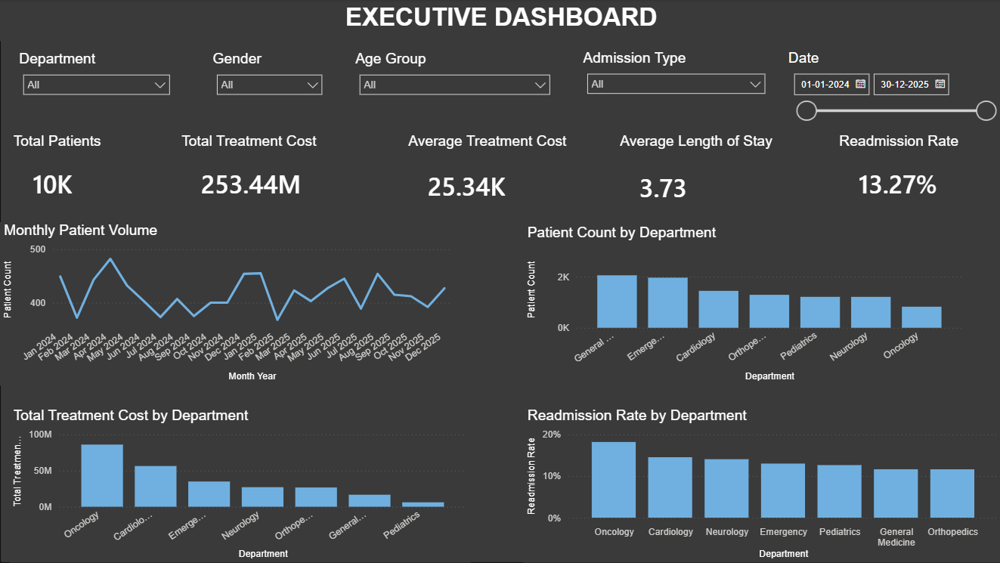

# 🏥 Healthcare Patient Analytics Dashboard

### Power BI | Power Query | DAX | Microsoft Excel

An interactive Healthcare Patient Analytics project developed using Microsoft Power BI to analyse patient demographics, hospital department performance, treatment costs, patient outcomes and readmission patterns.

The project transforms healthcare data into meaningful business insights through interactive dashboards and visual reports, helping hospital management understand operational performance and identify areas for improvement.

---

## 📊 Dashboard Preview



---

## 🎯 Project Objective

The main objective of this project is to analyse hospital patient data and provide meaningful insights into healthcare operations.

This project focuses on answering important business questions:

- Which hospital departments handle the highest number of patients?
- Which departments have the highest treatment costs?
- How does patient distribution vary by age group and gender?
- Which departments have higher readmission rates?
- What are the trends in treatment costs over time?
- How do patient outcomes and satisfaction vary across departments?
- What areas could hospital management improve?

---

## 📌 Key Performance Indicators (KPIs)

The dashboard highlights the following key metrics:

| KPI | Value |
|---|---:|
| Total Patients | 10,000 |
| Total Treatment Cost | ₹253.44 Million |
| Average Treatment Cost | ₹25.34K |
| Average Length of Stay | 3.73 Days |
| Readmission Rate | 13.27% |

---

## 🛠️ Tools & Technologies Used

| Tool | Purpose |
|---|---|
| Microsoft Excel | Dataset storage and initial inspection |
| Power Query | Data cleaning and transformation |
| Power BI | Interactive dashboard development |
| DAX | Calculated measures and KPI analysis |
| Data Modelling | Relationship management and date table creation |
| GitHub | Project version control and portfolio presentation |

---

## 🔄 Data Analysis Process

The project followed these major stages:

1. Data Collection
2. Data Understanding
3. Data Cleaning and Transformation
4. Data Modelling
5. DAX Measure Creation
6. Dashboard Development
7. Business Insights and Recommendations

---

## 🧹 Data Preparation & Cleaning

The healthcare dataset was imported into Power BI and prepared using Power Query.

The following data preparation steps were performed:

- Inspected the dataset and reviewed column structures.
- Removed duplicate patient records using Patient ID.
- Replaced missing Doctor and Insurance Type values with "Unknown".
- Retained missing Patient Satisfaction values rather than assuming satisfaction scores.
- Corrected column data types.
- Created Age Group categories.
- Created Stay Category classifications.
- Prepared the dataset for analysis and visualisation.

**Final dataset:** 10,000 patient records.

---

## 🗂️ Data Modelling

A Date Table was created to support time-based analysis.

The Date Table was connected to the healthcare dataset using the Admission Date column.

The relationship was configured as:

- One-to-Many (1:*)
- Active relationship
- Date Table marked as the official date table

This supports monthly and time-based analysis in the dashboard.

---

## 🧮 DAX Analysis

DAX measures were created to calculate important healthcare performance indicators.

Some of the key measures include:

- Total Patients
- Total Admissions
- Total Treatment Cost
- Average Treatment Cost
- Average Length of Stay
- Readmission Rate
- Average Patient Satisfaction
- Total Readmitted Patients
- Total Recovered Patients
- Recovery Rate
- Total Long Stay Patients
- Total Medium Stay Patients
- Total Short Stay Patients
- Average Cost per Patient

These measures help generate dynamic KPIs and interactive visualisations.

---

# 📈 Dashboard Pages

The report contains six interactive dashboard pages.

## 1. Executive Dashboard


Provides a high-level overview of hospital performance.

**Key highlights:**
- Total Patients
- Average Treatment Cost
- Total Treatment Cost
- Readmission Rate
- Monthly Patient Trend
- Patients by Department
- Treatment Cost by Department
- Patient Outcome Distribution

**Purpose:** Gives hospital management a quick overview of important healthcare performance metrics.

---

## 2. Patient & Demographic Analysis


Analyses patient demographics and admission patterns.

**Key highlights:**
- Patients by Gender
- Patients by Age Group
- Patients by Admission Type
- Patients by Insurance Type
- Department and Admission Type Analysis
- Age Group and Gender Analysis

**Purpose:** Helps understand patient demographics and the distribution of hospital admissions.

---

## 3. Department Performance


Evaluates the performance of different hospital departments.

**Key highlights:**
- Patient Count by Department
- Department Performance Summary
- Average Length of Stay
- Average Treatment Cost
- Readmission Rate
- Patient Satisfaction
- Treatment Cost vs Readmission Rate

**Purpose:** Helps identify departments with higher patient volumes, treatment costs and readmission rates.

---

## 4. Financial & Treatment Analysis


Focuses on hospital treatment expenses and financial patterns.

**Key highlights:**
- Treatment Cost by Department
- Monthly Treatment Cost Trend
- Cost by Treatment Type
- Average Cost by Admission Type
- Treatment Cost Distribution

**Purpose:** Helps understand treatment expenses and identify areas where hospital costs are concentrated.

---

## 5. Outcomes & Readmission Analysis


Examines patient outcomes, recovery patterns and readmissions.

**Key highlights:**
- Patient Outcome Distribution
- Readmission Rate by Department
- Readmission by Admission Type
- Patient Satisfaction by Department
- Recovery Rate by Month

**Purpose:** Helps evaluate patient outcomes and identify departments that may require further investigation into readmission patterns.

---

## 6. Patient Details


Provides a detailed view of individual patient records.

**Key highlights:**
- Male Patient Count
- Female Patient Count
- Average Patient Age
- Patient Details Table
- Patient ID Filter

**Purpose:** Allows users to explore patient-level information and filter records using Patient ID.

---

# 💡 Key Business Insights

Based on the analysis of 10,000 patient records, the following observations were identified:

### 1. Patient Distribution
- General Medicine recorded the highest patient count with 2,055 patients.
- This indicates a higher patient volume in General Medicine compared with the other departments.

### 2. Treatment Cost
- Oncology recorded the highest total treatment cost of approximately ₹85.93 million.
- This makes Oncology the department with the largest overall treatment expenditure.

### 3. Length of Stay
- Oncology recorded the highest average length of stay at 7.13 days.
- This indicates that patients in Oncology had longer hospital stays on average.

### 4. Readmission Rate
- Oncology recorded the highest readmission rate at 18.18%.
- This department may require further analysis to understand the factors associated with readmissions.

### 5. Patient Satisfaction
- Neurology recorded the highest average patient satisfaction score of 3.98 out of 5.

---

## 🚀 Business Recommendations

Based on the dashboard findings, the following recommendations could be considered by hospital management:

1. **Department Resource Planning:** Review staffing, equipment and resource allocation in departments with higher patient volumes.

2. **Treatment Cost Monitoring:** Examine the major contributors to Oncology treatment expenses to improve cost visibility and financial planning.

3. **Readmission Analysis:** Investigate possible reasons for the higher readmission rate in Oncology and evaluate opportunities to improve follow-up care.

4. **Length of Stay Monitoring:** Review patient care pathways and discharge processes in departments with longer average stays.

5. **Patient Satisfaction:** Study practices in departments with higher satisfaction scores and identify opportunities to improve patient experience across other departments.

---

## 📁 Project Structure

```text
healthcare-patient-analytics-powerbi/
│
├── Dataset/
│   └── Healthcare_Patient_Analytics_Project.xlsx
│
├── PowerBI/
│   └── Healthcare dashboard.pbix
│
├── Screenshots/
│   ├── Executive_Dashboard.png
│   ├── Patient_Demographic_Analysis.png
│   ├── Department_Performance.png
│   ├── Financial_Treatment_Analysis.png
│   ├── Outcomes_Readmission_Analysis.png
│   └── Patient_Details.png
│
├── Documentation/
│
└── README.md
```

---

## 👨‍💻 Author

**Dhanush K**

Aspiring Data Analyst

Skills: Microsoft Excel | SQL | Power BI | Python | Data Analysis

---

## ⚠️ Disclaimer

This project is developed for educational and portfolio purposes using a healthcare dataset.

The analysis and recommendations are intended to demonstrate data analytics and visualisation skills. They should not be treated as medical advice or used as a substitute for professional clinical decision-making.

---

⭐ If you find this project interesting, feel free to explore the dashboards and analysis!
